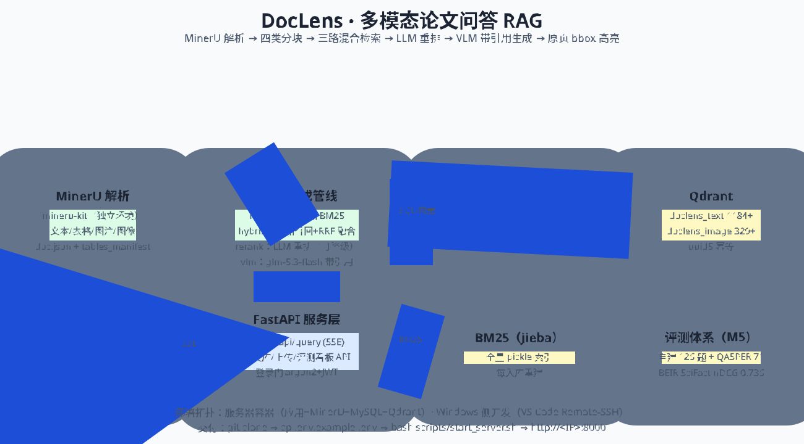

<div align="center">

# DocLens · 多模态论文问答 RAG

**学术论文 PDF 问答：MinerU 解析 → 三路混合检索 → LLM 重排 → 带引用生成 → 原页 bbox 高亮**

[](https://www.python.org/)
[](https://fastapi.tiangolo.com/)
[](https://react.dev/)
[](#license)

*学术论文 PDF 问答 · 图表/表格多模态检索 · 引用可溯源到原页 · 评测看板*

</div>

---

## 目录

- [它是什么](#它是什么)
- [功能演示](#功能演示)
- [两条命令跑通](#两条命令跑通)
- [系统架构](#系统架构)
- [评测结果](#评测结果)
- [关键特性](#关键特性)
- [配置参考](#配置参考)
- [Windows 开发模式](#windows-开发模式)
- [FAQ](#faq)
- [License](#license)

## 它是什么

DocLens 是一个**多模态学术论文问答系统**：把 11 篇学术论文 PDF 解析成文本/表格/图注/图像四类单元，三路混合检索（文本向量+图像向量+BM25）后经 LLM 重排，由 VLM 生成**带 [n] 引用标注**的流式答案——点击引用可以跳到 **PDF 原页并高亮出处区域**。附论文库（上传即入库）、三模型切换、六档消融与公开基准（QASPER/BEIR）评测看板。

## 功能演示

> 截图四宫格：登录门 → 流式对话+思考面板 → 引用点击→PDF 原页 bbox 高亮 → 评测看板

| | |
|:---:|:---:|
|  |  |
|  |  |

*（截图占位：`docs/images/screenshot-*.png`——录制/截图后补齐）*

## 两条命令跑通

> 前置：一台 Linux 服务器（或容器）+ Python 3.12 + MySQL 8 + Qdrant + 一把火山方舟 [ARK_API_KEY](https://console.volcengine.com)。服务器栈部署说明见 [docs/deploy.md](docs/deploy.md)。

**命令 ①** —— 克隆并配置（填一把 ARK_API_KEY 即可跑通问答；存储连接按你的环境改）：

```bash
git clone https://github.com/Asparetire/RAG.git && cd RAG
cp .env.example .env && vi .env   # 至少填 ARK_API_KEY
```

**命令 ②** —— 启动（含前端构建产物托管，免 Docker、免 Node）：

```bash
bash scripts/start_server.sh      # 依赖自动检查 + 健康检查重试
```

打开 `http://<服务器IP>:8000/web/`，用 `.env` 里的 `ADMIN_PASSWORD` 登录（首次登录即管理员）。

<details>
<summary><b>Windows 开发模式（VS Code Remote-SSH）</b></summary>

应用跑在服务器容器；Windows 侧改代码走 git 双端同步。本地访问存储需先建隧道：

```bash
ssh -N -L 13306:127.0.0.1:3306 -L 16333:127.0.0.1:6333 -L 8000:127.0.0.1:8000 root@<服务器> -p <SSH端口>
```

`.env` 里存储地址写 `127.0.0.1`（经隧道），前端热更新：`cd web && npm run dev` → `localhost:5173`。

</details>

## 系统架构



## 评测结果

**六档消融**（126 题自建题集，recall@5，全指标见 [reports/ablation.md](reports/ablation.md)）：

| 档位 | A 纯文本 | C +图像检索 | D +LLM 重排 | E +上下文增强 | F +多模态重排 |
|---|---|---|---|---|---|
| recall@5 | 0.186 | 0.354 | **0.495** | 0.507 | 0.511 |

*多模态检索与 LLM 重排是两大增益来源（A→C +90%，C→D +40%）——完整口径与统计检验见报告。*

**外部基准**：

| 基准 | 结果 | 说明 |
|---|---|---|
| QASPER 子集（71 题） | Answer-F1 + Evidence 映射 | 学术论文 QA 官方口径，33 题图表证据 |
| BEIR SciFact | nDCG@10 **0.736** | 超公开 BM25 基线（≈0.665） |
| BEIR NFCorpus | nDCG@10 0.334 | ≈公开 BM25 基线水平 |

*财报泛化包为零样本跨域评测（构建期不可见，BEIR 方法学），结果见 [docs/finance-generalization.md](docs/finance-generalization.md)。*

## 关键特性

- **多模态分块**：MinerU 解析 → 文本/表格/图注/图像四类单元，表格卡片化、图注绑定原图（bbox 0–1 归一化）
- **三路混合检索**：文本向量（doubao-embedding-vision）+ 图像向量 + BM25（jieba），客户端 RRF 融合+证据组归并
- **LLM 重排（可降级）**：列表式重排+结果缓存，超时自动回退融合序（降级率随 trace 记录）
- **带引用生成**：glm-5.3-flash 流式输出，[n] 引用四类格式全兼容，无依据自动拒答（judge 兜底）
- **原页溯源**：引用点击 → PDF 原页渲染 + bbox 区域高亮（浏览器原生查看器）
- **论文库**：上传 PDF → 后台解析入库 → 立即可问答（任务状态机+进度条）
- **三模型切换**：前端选择生成模型（白名单校验），答案标注所用模型
- **评测看板**：六档消融+QASPER 外部基准+模型对比，同源数据与报告一致

## 配置参考

完整字段见 [.env.example](.env.example)（含生成命令）。关键项：

| 变量 | 容器侧 | Windows 侧 | 说明 |
|---|---|---|---|
| `ARK_API_KEY` | 同 | 同 | 火山方舟密钥（必填） |
| `MYSQL_URL` | `…@127.0.0.1:3306/doclens` | 经隧道写 `127.0.0.1:13306` | 存储（勘误：3306 未对外发布） |
| `QDRANT_URL` | `http://127.0.0.1:6333` | 经隧道写 `127.0.0.1:16333` | 向量库 |
| `MINERU_BIN` | `/opt/conda/envs/doclens-mineru/bin/mineru-kit` | `D:\…\mineru-kit.exe` | PDF 解析桥接 |
| `ADMIN_PASSWORD` / `JWT_SECRET` | 随机生成 | 同 | 登录门（改密码即全端吊销） |
| `WEB_STATIC` | 交付态 `1` | 开发期 `0` | SPA 托管开关 |

## Windows 开发模式

见上方 [Windows 开发模式](#两条命令跑通) 折叠块：代码在 Windows 侧编辑（VS Code Remote-SSH 同步到容器），存储经 SSH 隧道访问，前端热更新 `npm run dev`。

## FAQ

<details>
<summary><b>pip install 慢/失败？</b></summary>

容器内 pip 默认源已切清华镜像（`pip config set global.index-url https://pypi.tuna.tsinghua.edu.cn/simple`）。
</details>

<details>
<summary><b>MySQL/Qdrant 连不上？</b></summary>

3306/6333 未对外发布：容器内写 `127.0.0.1` 直连；Windows 开发场景先建 SSH 隧道再写 `127.0.0.1:13306/16333`。
</details>

<details>
<summary><b>中文 PDF 渲染出来是乱码/空白？</b></summary>

cMaps 已随 dist 分发（`/web/pdfjs/`）——若自构建，确认 `vite-plugin-static-copy` 步骤执行。
</details>

<details>
<summary><b>上传论文后一直"解析中"？</b></summary>

MinerU 解析 1–3 分钟/篇（30 分钟超时兜底）；重启服务后超时任务会被启动扫描标记失败，可点重试。
</details>

## License

[MIT](LICENSE)
